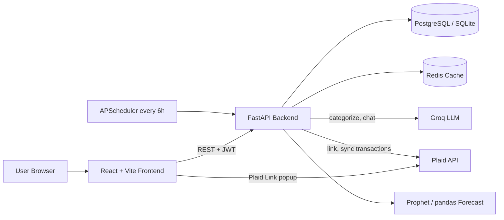

## Architecture



### How it works
1. The user registers and logs in. The backend returns a JWT, and the frontend sends it with every request.
2. The user clicks **Link bank account**. The backend asks Plaid for a link token, and the Plaid Link popup opens in the browser.
3. After the user logs in to the bank, the frontend sends a `public_token` to the backend, which exchanges it for an `access_token` and saves the accounts.
4. The backend pulls transactions with Plaid `transactions/sync`. A background job repeats this every 6 hours.
5. Each new transaction is categorized by keyword rules first. Anything unknown goes to the LLM.
6. The dashboard reads summaries, forecasts, subscriptions and budget alerts from the API. Redis caches the heavy queries.
7. In chat, the backend sends the user's last 90 days of transactions plus the question to the LLM and returns the answer.

### Project structure
```
finwise-ai/
├── backend/
│   ├── app/
│   │   ├── main.py            # App entry: routes, CORS, 6-hour sync scheduler
│   │   ├── config.py          # Environment settings (.env)
│   │   ├── database.py        # SQLAlchemy engine and sessions
│   │   ├── models/            # DB tables
│   │   │   ├── user.py        #   users (email, hashed password)
│   │   │   ├── account.py     #   linked bank accounts, Plaid token, sync cursor
│   │   │   ├── transaction.py #   transactions with category
│   │   │   └── insight.py     #   budgets and alerts
│   │   ├── schemas/           # Request/response validation (Pydantic)
│   │   ├── routers/           # API endpoints
│   │   │   ├── auth.py        #   register, login, me
│   │   │   ├── plaid.py       #   link token, exchange, sync, accounts
│   │   │   ├── transactions.py#   transaction list and spending summary
│   │   │   ├── insights.py    #   forecast, subscriptions, budgets, alerts
│   │   │   └── chat.py        #   AI chat endpoint
│   │   ├── services/          # Business logic
│   │   │   ├── plaid_service.py   # Plaid link and transaction sync
│   │   │   ├── categorizer.py     # Rules + LLM categorization
│   │   │   ├── ai_service.py      # LLM client and chat prompt
│   │   │   └── forecast_service.py# Forecasting and subscription detection
│   │   └── utils/
│   │       ├── security.py    # bcrypt hashing, JWT creation and check
│   │       └── cache.py       # Redis caching (optional)
│   ├── requirements.txt
│   └── Dockerfile
├── frontend/
│   ├── src/
│   │   ├── main.jsx, App.jsx  # Entry and login/dashboard switch
│   │   ├── api/client.js      # All backend API calls
│   │   ├── hooks/useApi.js    # Data fetching hook
│   │   ├── pages/Login.jsx    # Login and register screen
│   │   └── components/
│   │       ├── Dashboard.jsx      # Main layout and stats
│   │       ├── PlaidLink.jsx      # Bank linking button
│   │       ├── SpendingChart.jsx  # Category pie and forecast chart
│   │       ├── TransactionList.jsx# Recent transactions
│   │       ├── ChatAssistant.jsx  # Chat with your finances
│   │       └── BudgetAlerts.jsx   # Budget progress and alerts
│   ├── package.json
│   └── vite.config.js
├── docker-compose.yml         # Backend + frontend + Postgres + Redis
└── README.md
```

### Main API endpoints
| Method | Endpoint | Purpose |
|---|---|---|
| POST | `/api/auth/register`, `/api/auth/login` | Create account, get JWT |
| POST | `/api/plaid/link-token` | Start bank linking |
| POST | `/api/plaid/exchange` | Save linked accounts and sync |
| POST | `/api/plaid/sync` | Manual sync |
| GET | `/api/transactions`, `/api/transactions/summary` | Transactions and spending totals |
| GET | `/api/insights/forecast` | 30-day spending forecast |
| GET | `/api/insights/subscriptions` | Detected recurring charges |
| POST/GET | `/api/insights/budgets`, `/api/insights/alerts` | Set budgets, see alerts |
| POST | `/api/chat` | Ask questions about your finances |

### Database tables
- **users**: email and password hash
- **accounts**: bank accounts, Plaid access token, sync cursor, balance
- **transactions**: date, merchant, amount, category, pending flag
- **insights**: budgets and alerts per user
